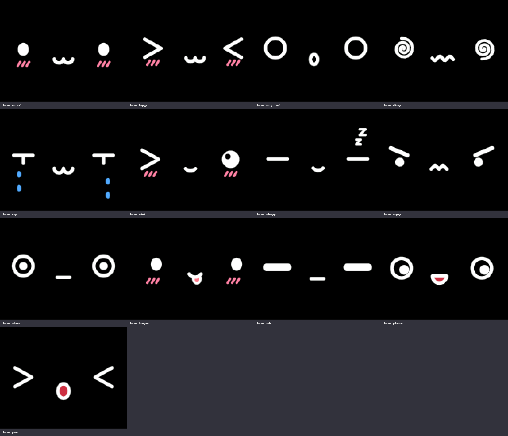
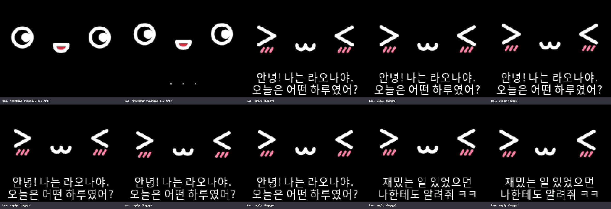
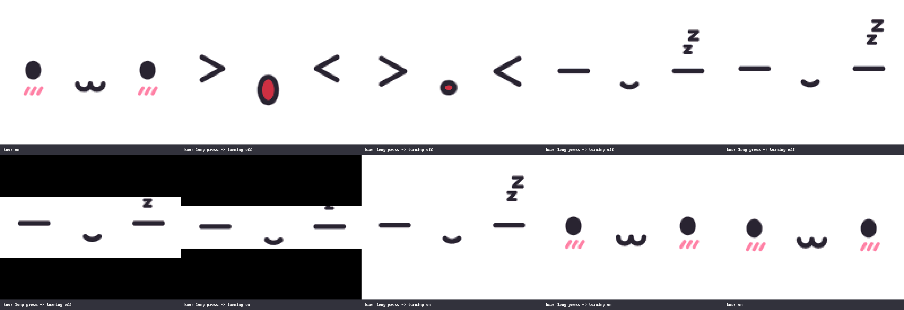

# Laona (라오나)

**ESP32로 만드는 오픈소스 AI 데스크 로봇.** 작은 화면에서 표정을 지으며 반응하고,
휴대폰으로 말을 걸면 **내 API 키**로 AI가 대답해 라오나 화면에 표정과 글자로 보여줍니다.
별도 서버 없이 라오나가 직접 AI API를 호출합니다.

> An open-source ESP32 desk robot with an expressive face. Talk to it from your phone's browser;
> it answers on its own screen using your own AI API key (Claude, ChatGPT, Gemini, or a local LLM).
> No server required. Documentation is in Korean.



## 주요 기능

- **표정 얼굴** — 이모티콘 얼굴 12가지(`kao`)와 흰 둥근 눈(`eyes`) 두 가지 스타일. 깜빡임, 두리번거림, 숨쉬기, 표정별 애니메이션
- **휴대폰으로 대화** — 같은 와이파이에서 브라우저로 접속해 말을 걸면, 대답은 라오나 화면 아래 두 줄에 한글로 나옴
- **내 API 키로 동작 (BYOK)** — Claude, ChatGPT, Gemini, 또는 Ollama·LM Studio 같은 OpenAI 호환 로컬 LLM.
  카드 등록 없이 시작하려면 **Google AI Studio 무료 키** (설정에서 "Google AI Studio 무료" 선택)
- **서버 없음** — 웹서버와 API 호출이 모두 라오나 안에서 동작
- **한글 글꼴 내장** — 한글 11,172자 + 자모(ㅋㅋ, ㅠㅠ) + 영문, 회색조 안티에일리어싱
- **터치 센서와 버튼 하나로 조작** — 스타일 전환, 흑백 반전, 화면 끄기/켜기 (하품하고 잠드는 연출), 와이파이 설정과 접속 QR 코드
- **어린이를 고려한 기본 지시문** — 짧고 다정한 말투, 부적절한 주제 피하기, 개인정보 묻지 않기



## 하드웨어

| 부품 | 예시 |
|---|---|
| ESP32-C3 보드 (4MB 플래시, 내장 USB) | ESP32-C3 SuperMini |
| 1.8" TFT LCD 128x160, SPI | ST7735S 컨트롤러 모듈 |
| 디지털 터치 센서 | TTP223 (터치하면 High) |
| 택트 스위치 | 누르면 GND 에 붙도록 연결 (내부 풀업) |

### 배선

| ESP32-C3 | LCD | | ESP32-C3 | 터치 센서 / 버튼 |
|---|---|---|---|---|
| GPIO0 | RESET | | GPIO4 | 터치 OUT (SIG) |
| GPIO1 | DC (A0) | | 3.3V | 터치 VCC |
| GPIO2 | CS | | GND | 터치 GND |
| GPIO3 | BL (백라이트) | | GPIO5 | 택트 스위치 한쪽 (다른 쪽은 GND) |
| GPIO8 | SDA (MOSI) | | | |
| GPIO9 | SCL (SCLK) | | | |
| 3.3V / GND | VCC / GND | | | |

- LCD 핀 이름의 SDA/SCL 은 I2C 가 아니라 SPI 의 데이터/클럭입니다.
- 터치 센서가 터치할 때 Low 를 내보내는 설정이면 `main/touch.c` 의 `TOUCH_ACTIVE` 를 `0` 으로 바꾸세요.
- 빨강/파랑이 바뀌어 보이면 `main/lcd.c` 의 `MADCTL` 값에서 BGR 비트(0x08)를 조정하세요.

## 빌드와 다운로드

[ESP-IDF v5.5](https://docs.espressif.com/projects/esp-idf/) 가 `~/esp/esp-idf` 에 설치되어 있다고 가정합니다.

```bash
~/esp/esp-idf/install.sh esp32c3   # 처음 한 번 (RISC-V 툴체인)
make                               # 빌드 (mdns, qrcode 컴포넌트는 자동으로 내려받음)
./fusing.sh                        # 다운로드 (기본 포트 /dev/ttyACM0)
```

- 포트가 다르면 `PORT=/dev/ttyUSB0 ./fusing.sh`
- 콘솔은 내장 USB 로 열립니다: `minicom -D /dev/ttyACM0` (다운로드 전에는 minicom 을 종료)

## 처음 설정

1. **와이파이 연결** — 켜면 검은 바탕 얼굴이 나오고, 저장된 와이파이가 있으면 화면 표시 없이 연결합니다.
   연결되면 화면 오른쪽 위에 와이파이 아이콘이 나옵니다. 연결하지 못하면 와이파이를 끄고 얼굴만 보여 줍니다.
   처음이거나 와이파이를 바꾸려면 **버튼을 3초** 누르세요. 화면에 와이파이 QR 이 나옵니다. (한 번만 하면 기억함)
   1. 휴대폰 카메라로 QR 을 찍어 라오나의 설정용 와이파이(`Laona-XXXX`)에 접속합니다.
      QR 을 못 쓰는 휴대폰은 와이파이 목록에서 `Laona-XXXX` 를 고르고 화면 아래의 암호를 입력하세요.
   2. 설정 창이 저절로 뜹니다. 안 뜨면 화면이 두 번째 QR(`http://4.3.2.1`)로 바뀌니 그것을 찍으세요.
   3. 집 와이파이를 고르고 비밀번호를 넣어 **연결**. 연결되면 라오나가 얼굴로 돌아와 기쁜 표정으로 "와이파이에 연결됐어요!" 를 보여 줍니다.
   - 설정용 와이파이에 접속한 휴대폰이 없으면 QR 은 1분 뒤 닫히고 와이파이가 꺼집니다.
   - USB 콘솔에서도 됩니다: `wifi scan`, `wifi connect <번호 또는 SSID> <비밀번호>`
2. **휴대폰으로 접속** — 와이파이에 연결된 상태에서 **버튼을 한 번** 누르면 화면에 대화창 QR 코드가 나옵니다.
   휴대폰 카메라로 찍어 대화창이 열리면 화면은 바로 얼굴로 돌아갑니다. (접속하지 않으면 1분 뒤 닫힘.
   `http://laona.local` 도 됩니다. 안드로이드는 안 될 수 있음)
3. **AI 설정** — 대화 페이지 오른쪽 위 ⚙ → 설정 비밀번호 만들기 → 서비스, 모델, API 키 입력 → 저장
4. 대화 페이지에서 말을 걸면 라오나 화면에 대답이 나옵니다.

> **API 요금 주의** — 사용 요금은 키 주인의 계정에 청구됩니다. 아이들은 오래 대화하는 경우가 많으니
> 꼭 API 계정에 **월 사용 한도**를 정해 두세요. 저렴하게 쓰려면 가벼운 모델(예: `claude-haiku-5-5`)을 고르세요.

> **무료로 시작하기 (Google AI Studio)** — [aistudio.google.com/apikey](https://aistudio.google.com/apikey) 에서 구글 계정으로
> 로그인해 API 키를 만들면 카드 등록 없이 쓸 수 있습니다. 설정에서 **Google AI Studio 무료** 를 고르고 키를 넣으세요.
> 모델은 `gemini-3.8-flash` 또는 `gemini-3.5-flash-lite` (무료 제공 모델). 하루 사용량이 정해져 있어 다 쓰면
> 다음 날(태평양 시간 자정, 한국 오후 4~5시) 다시 됩니다. 무료 사용 중에는 대화 내용이 구글 서비스 개선에 쓰일 수 있으니,
> 아이가 쓸 때는 이 점을 알고 쓰세요.

## 터치·버튼 조작

| 동작 | 결과 |
|---|---|
| 한 번 | 얼굴 스타일 바꾸기 (kao ↔ eyes) |
| 빠르게 두 번 | 흑백 반전 (스타일을 바꿔도 유지) |
| 1.5초 이상 누름 | 화면 끄기 (하품 → 잠들기 → 위아래로 닫힘) / 다시 누르면 켜기 |
| QR 이 떠 있을 때 터치 | QR 닫기 (와이파이 설정 중에는 와이파이 QR ↔ 설정 주소 QR) |
| 버튼 한 번 | 대화창 QR 코드 (와이파이에 연결되어 있을 때만. 휴대폰이 접속하거나 1분 지나면 닫힘) |
| 버튼 3초 누름 | 와이파이 설정 QR (화면이 꺼져 있어도 켜지며 표시) |



## 콘솔 명령

| 명령 | 설명 |
|---|---|
| `laona` | 상태 (스타일, 표정, 프레임 시간) |
| `laona <표정>` | normal happy surprised dizzy cry sad wink sleepy angry stare tongue meh glance |
| `laona style kao\|eyes`, `laona invert`, `laona flip` | 스타일, 흑백 반전, 화면 180도 회전 |
| `laona screen on\|off`, `laona qr` | 화면 끄기/켜기, 접속 QR |
| `laona say <표정> <말>` | API 없이 대답 표시 시험 |
| `chat <말>` / `chat forget` | 콘솔에서 말 걸기 (영문만) / 대화 기억 지우기 |
| `setup` / `setup reset` | AI 설정 보기 (키는 표시 안 함) / 설정과 비밀번호 초기화 |
| `wifi scan\|connect\|status\|disconnect\|forget` | 와이파이 |
| `wifi setup` / `wifi setup stop` | 휴대폰 와이파이 설정 모드 켜기/끄기 |
| `hello`, `ver`, `lcdout <색>` | 인사, 버전, 화면 단색 채우기 |

## 프로젝트 구조

```
main/
  face.c      얼굴 태스크 (25fps), 표정·스타일·화면 끄기 연출, QR 화면, 콘솔 laona 명령
  kao.c       이모티콘 얼굴 그리기 (안티에일리어싱 선, 순수 C)
  eyes.c      흰 둥근 눈 얼굴 (순수 C)
  seq.c       화면 끄기/켜기 연출 시간표 (순수 C)
  text.c      아래 두 줄 한글 글자 영역 (순수 C)
  icon.c      상태 아이콘 (와이파이, 순수 C)
  llm.c       AI API 호출 (Claude / OpenAI 형식), 대화 기억
  web.c       휴대폰용 웹서버, mDNS, 접속 QR
  config.c    AI 설정과 설정 비밀번호 (NVS)
  lcd.c       ST7735S SPI 드라이버
  touch.c     터치 제스처 (1/2번, 길게), 버튼 (한 번: 대화창 QR, 3초: 와이파이 설정)
  wifi.c      와이파이 연결과 콘솔 명령
  wifi_setup.c  휴대폰 와이파이 설정 (설정용 AP + 캡티브 포털 + 화면 QR)
  chat.html, settings.html, setup.html   휴대폰 페이지
  font.bin    한글 비트맵 글꼴 (tools/make_font.py 로 생성)
preview/      PC 에서 같은 그리기 코드로 GIF/PNG 미리보기 (make)
tools/        글꼴 생성기
```

`kao.c`, `eyes.c`, `seq.c`, `text.c` 는 ESP-IDF 에 의존하지 않아 PC 에서 그대로 컴파일됩니다.
얼굴이나 화면을 바꿀 때는 `preview/` 에서 `make` 로 GIF 를 먼저 확인하세요.

## 보안과 안전

- API 키는 라오나(NVS)에만 저장되고 웹 페이지로 다시 보내지 않습니다.
- 설정 페이지는 비밀번호로 보호되지만 **집 와이파이 안에서 암호화 없이(http)** 주고받습니다. 공용 와이파이에서 설정하지 마세요.
- 기기를 남에게 줄 때는 `setup reset` 으로 키를 지우세요. (플래시 암호화는 아직 기본으로 켜져 있지 않습니다)
- 라오나는 어린이가 사용할 수 있으므로 지시문에 안전 규칙이 들어 있지만, AI 의 대답이 항상 적절하다고 보장할 수는 없습니다. 보호자의 관심이 필요합니다.

## 앞으로

- ESP32-S3 지원, 마이크·스피커
- 같은 와이파이의 라오나끼리 함께 대화

## 라이선스

[GNU General Public License v3.0](LICENSE). 포함된 글꼴과 라이브러리의 라이선스는 [THIRD_PARTY_NOTICES.md](THIRD_PARTY_NOTICES.md) 를 보세요.
